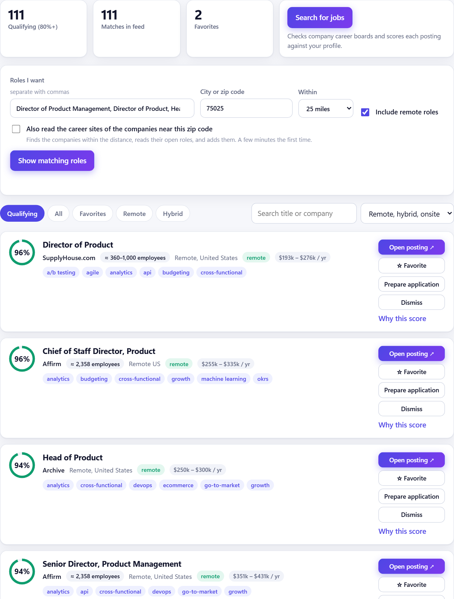
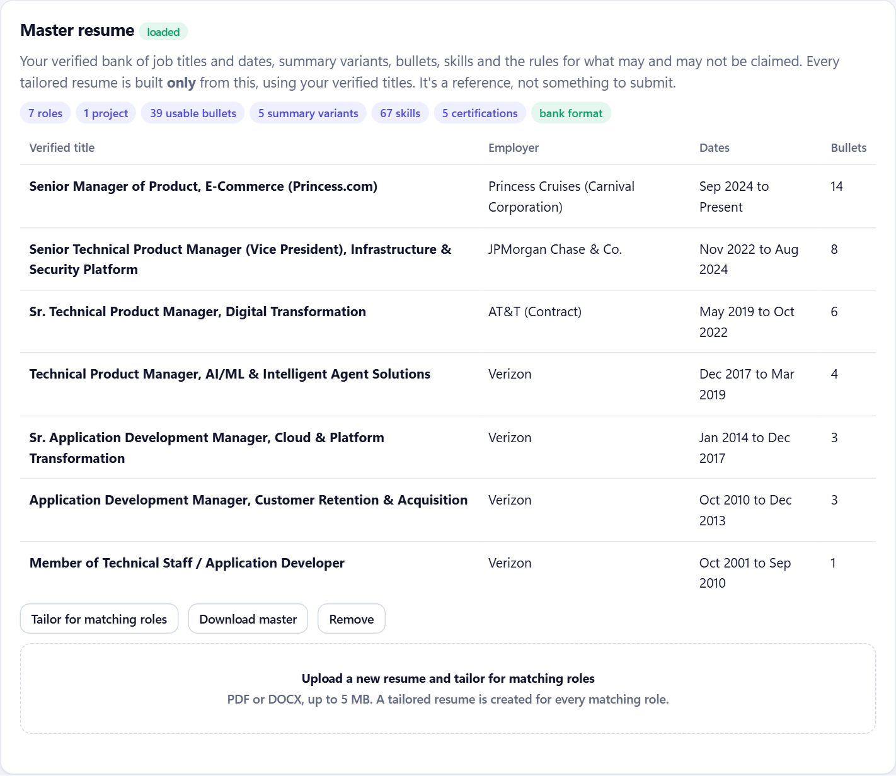
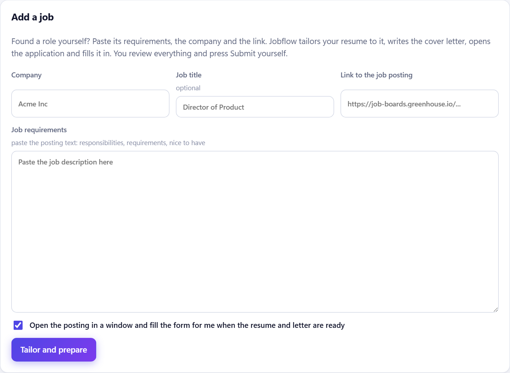

# Jobflow

Jobflow is a job-search and application agent I built for my own search. It finds product roles that fit my background, explains each fit score, tailors a resume and cover letter from a locked set of facts, and fills in applications so that I only review and press Submit.

I built it by writing specifications in plain English and running [Claude Code](https://claude.com/claude-code) as the agentic harness. The code was written by the agent; the requirements, acceptance rules, guardrails and product decisions are mine. [How I built it](docs/how-it-was-built.md) walks through that loop with real examples.

**The source code is private.** This repository holds the overview, the architecture and screenshots of the working app. I'm glad to walk through the code on a call: reach me on [LinkedIn](https://www.linkedin.com/in/vijaybamane).

## What it does

- Pulls open roles from company career boards on Greenhouse, Lever, Ashby, SmartRecruiters, Workable and Workday, plus the free Himalayas, Jobicy and Arbeitnow boards. It uses only free, public feeds with no sign-up.
- Finds employers within a set radius of a zip code using OpenStreetMap and Wikidata, then reads their career sites for matching roles.
- Scores every posting against my master resume and shows why it scored the way it did. Roles at 80% or higher qualify; roles at 90% or higher are prepared for me automatically.
- Hides postings that have no direct employer link to apply, since those usually end at an aggregator's sign-up page.
- Shows the employer's approximate headcount next to each job, from Wikipedia, the Y Combinator company list or the posting itself.
- Reads plain-English searches such as "remote director of product in fintech, 200k+" with the Claude API, and falls back to a rule-based parser when no model is available.
- Tailors a resume and cover letter for each role from a master resume whose facts cannot change, and saves both as Word files.
- Opens the application, fills every field it can answer truthfully, attaches the files, and leaves the final Submit to me. It marks the job Applied only after the employer's site confirms the submission.

## Screenshots

The job feed, ranked by fit, with company size, pay range and the skills that matched:

The master resume: verified titles and dates that every tailored resume is built from:

Adding a job found elsewhere. Jobflow tailors the resume and letter, then opens and fills the application:

## Guardrails

Applying for jobs on someone's behalf goes wrong quickly if the software guesses, so most of the design is about when it stops.

- It never solves a CAPTCHA, never reads an emailed or texted verification code, and never creates an account or types a password. Any of these hands the job back to me.
- It never guesses an answer. A required question with no answer in my profile stops the application and records the exact question.
- It sends at most 10 applications a day.
- Tailored resumes use only facts from the master resume. Titles, dates, employers and numbers are copied as they are, and every line is checked for tense, voice and stock phrases.
- Personal details are encrypted at rest with a separate data key for each user.

## How it fits together

See [the architecture notes](docs/architecture.md) for the diagram and the main design decisions.

## Built with

Python and FastAPI, SQLite, a plain JavaScript front end, Playwright for browser automation, the Claude API for language tasks, and Terraform for the cloud infrastructure. The test suite has 191 automated tests.

## License

Copyright (c) 2026 Vijay Bamane. All rights reserved. See [LICENSE](LICENSE).
