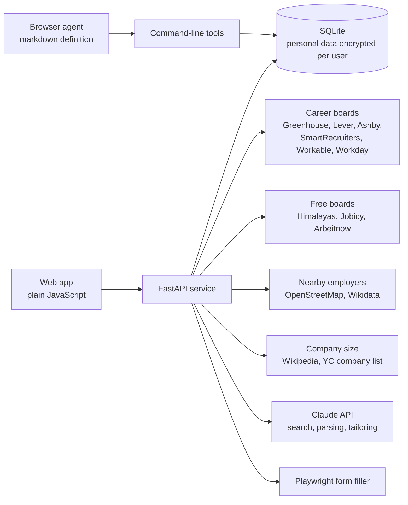

# Architecture

Jobflow is a single FastAPI service with a plain JavaScript front end. It runs on my laptop today, and the Terraform definitions describe the cloud version (network, compute, data, auth and monitoring).

## The pipeline

1. **Find.** A scheduled refresh reads the career boards and free job boards for the titles I want. A zip-code scan finds employers within a set radius and reads their boards too.
2. **Resolve.** For a posting that came through an aggregator, Jobflow looks for the same role on the employer's own board. Postings with no direct link are hidden.
3. **Score.** Each posting is scored against the master resume on skill coverage (35 points), seniority (20), title fit (20), years of experience (15) and overall text similarity (10). Location, remote work and pay act as filters. The score comes with a "why" panel, and the scoring is plain code, so the same posting always gets the same score.
4. **Tailor.** For roles that qualify, Jobflow builds a resume and cover letter from the master resume. It picks the summary variant, bullets and skills that fit the posting and never changes a fact.
5. **Apply.** The form filler opens the application, answers what it can from my profile, attaches the files and either submits or hands the open browser to me. It marks the job Applied only when the site confirms.
6. **Track.** Applied jobs, outcomes and notes live in one table, along with the daily count against the cap of 10.

## Design decisions

**Language models read; code decides.** The Claude API turns a plain-English search into structured criteria and helps parse and tailor resumes. Filtering and scoring stay in deterministic code, and the app shows how it read each search so I can correct it.

**Facts are locked.** The master resume is the only source for titles, dates, employers and numbers. Tailoring selects and orders; it does not invent. Each line is checked for past tense, me as the actor, and stock phrases before it reaches a resume.

**The person owns the risky steps.** CAPTCHAs, verification codes, account sign-ups and unanswered questions always come back to me. In hand-off mode the app fills everything and leaves Submit to me.

**Free, public data only.** Every job source is a public feed that needs no sign-up, email registration or paid plan. Connectors that needed one were removed.

**Privacy by default.** Personal details are encrypted with a per-user data key. With sign-in turned off for local development, the app serves only its owner on this computer and rejects requests from other hosts or origins. The production configuration refuses to start with sign-in off.
